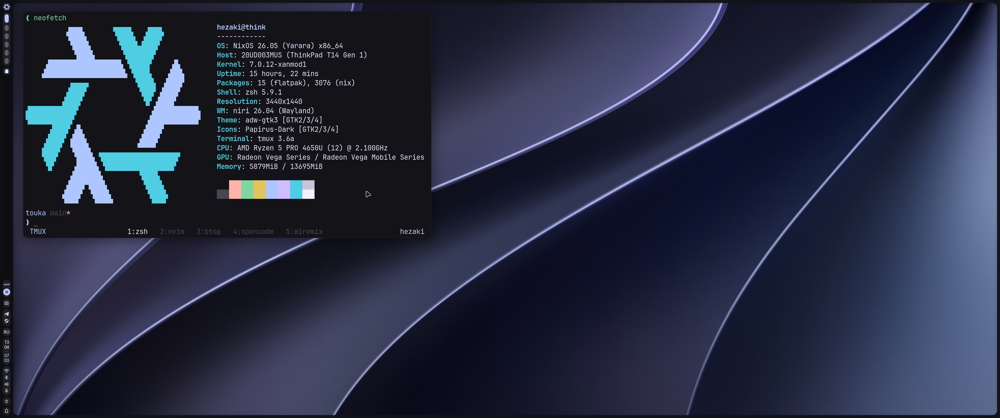

<h1 align="center">Touka</h1>
<p align="center">Я люблю большие сиськи</p>


## ℹ️Information
I recommend using  [nh](https://github.com/viperML/nh), if you don't have it then:

``` bash
nix shell nixpkgs#nh
```

Build host:
``` bash
nh os switch . -a                         # or nixos-rebuild switch --flake .#think
```

Build home-manager on desktop:
``` bash
nh home switch . -a                       # or home-manager switch --flake .#hezaki
```

## 💻Hardware
- Laptop — [Lenovo ThinkPad T14 gen 1](https://www.lenovo.com/us/en/p/laptops/thinkpad/thinkpadt/t14-amd-g1/22tpt14t4a2)
	- An excellent office laptop, there is a profile in [nixos-hardware](https://github.com/NixOS/nixos-hardware/blob/master/lenovo/thinkpad/t14/amd/gen1)

Why Touka? I'm just a big fan of [Touka Kirishima](https://tokyoghoul.fandom.com/wiki/Touka_Kirishima)  from TK)))
